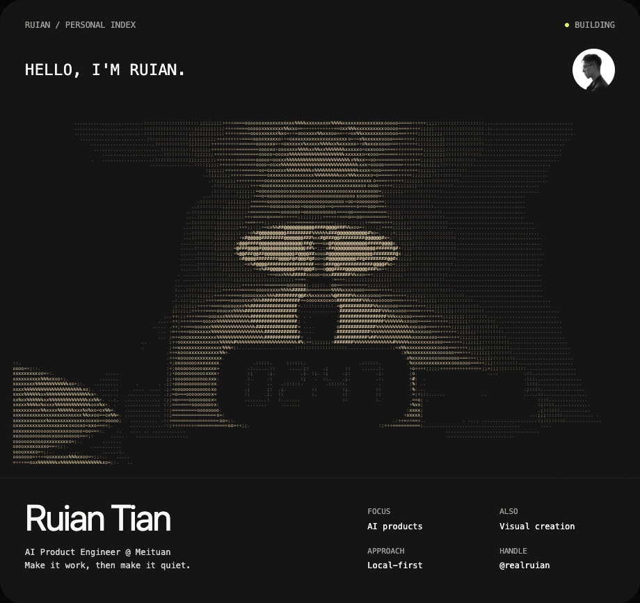
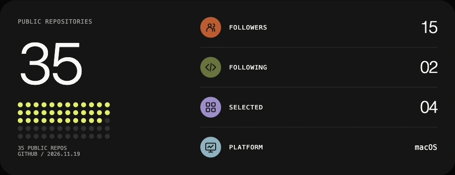
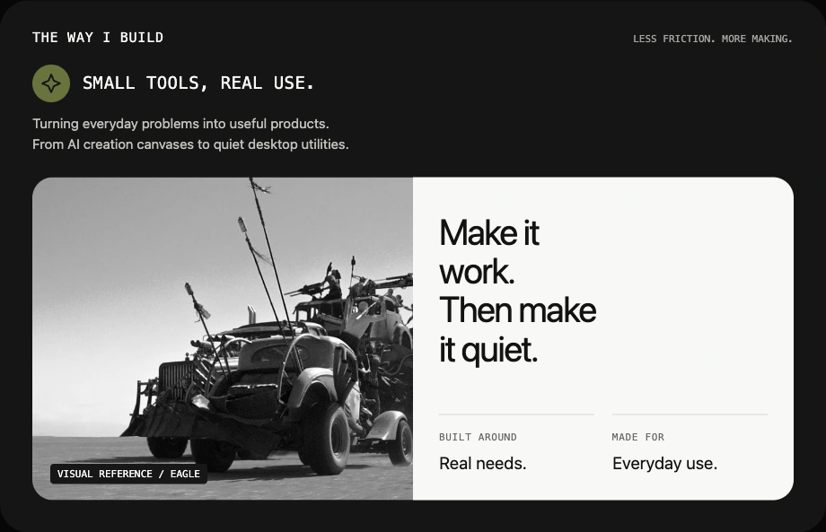
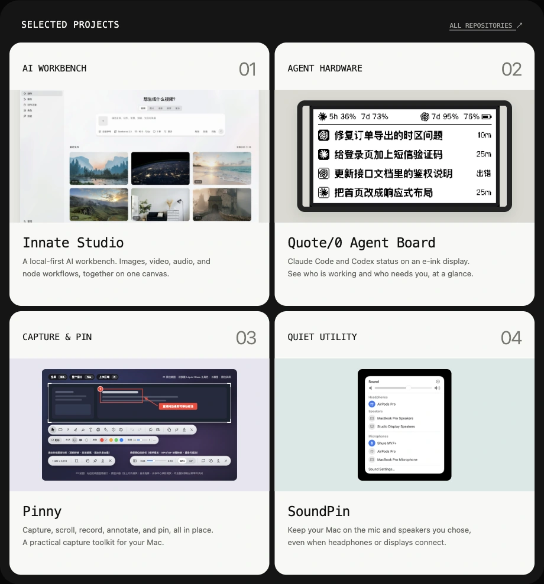

<!-- Profile artwork: English long-form layout, After Hours cover. -->

  <a href="https://tianruian.com">
    <picture>
      <source media="(max-width: 767px)" srcset="assets/profile/mobile-0.webp">
      
    </picture>
  </a>

  <a href="https://github.com/realruian?tab=repositories">
    <picture>
      <source media="(max-width: 767px)" srcset="assets/profile/mobile-1.webp">
      
    </picture>
  </a>

  <picture>
    <source media="(max-width: 767px)" srcset="assets/profile/mobile-2.webp">
    
  </picture>

  <picture>
    <source media="(max-width: 767px)" srcset="assets/profile/mobile-3.webp">
    
  </picture>

  <a href="https://github.com/realruian/innate-studio">Innate Studio ↗</a> &nbsp;·&nbsp;
  <a href="https://github.com/realruian/quote0-agent-board">Quote/0 Agent Board ↗</a> 
  <a href="https://github.com/realruian/Pinny">Pinny ↗</a> &nbsp;·&nbsp;
  <a href="https://github.com/realruian/SoundPin">SoundPin ↗</a> &nbsp;·&nbsp;
  <a href="https://github.com/realruian?tab=repositories">All repositories ↗</a>

  <picture>
    <source media="(max-width: 767px)" srcset="assets/profile/mobile-4.webp">
    
  </picture>

  <picture>
    <source media="(max-width: 767px)" srcset="assets/profile/mobile-5.webp">
    
  </picture>

  <samp>
    <a href="https://tianruian.com">WEBSITE ↗</a> &nbsp;·&nbsp;
    <a href="https://github.com/realruian">GITHUB ↗</a> &nbsp;·&nbsp;
    <a href="https://x.com/realruian">X / TWITTER ↗</a> &nbsp;·&nbsp;
    <a href="mailto:realruian@gmail.com">EMAIL ↗</a>
  </samp>

About & project details

**Ruian Tian · @realruian** — AI Product Engineer at Meituan.

Make it work, then make it quiet. I build AI products, local-first apps, and practical desktop tools. I also explore visual creation and turn methods into hands-on courses.

- [Innate Studio](https://github.com/realruian/innate-studio): a local-first AI workbench with images, video, audio, and node workflows on one canvas.
- [Quote/0 Agent Board](https://github.com/realruian/quote0-agent-board): Claude Code and Codex status on an e-ink display.
- [Pinny](https://github.com/realruian/Pinny): capture, scrolling screenshots, recording, annotation, and pinning for macOS.
- [SoundPin](https://github.com/realruian/SoundPin): keep your Mac on the microphone and speakers you chose.

GitHub statistics are a snapshot from November 19, 2026. Project screenshots come from their repositories. The cover and atmosphere photo are decorative references selected from my Eagle collection.

